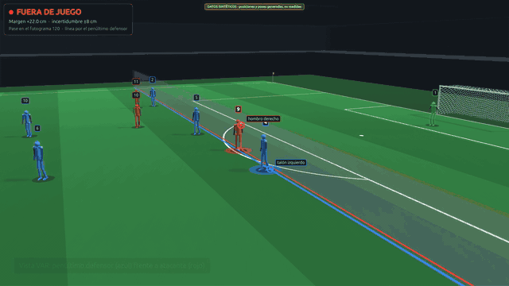
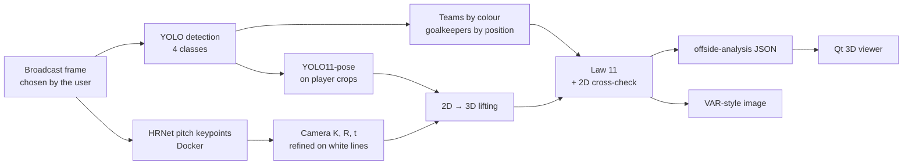
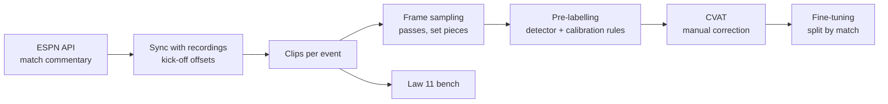

# Offside Detection

**Semi-automatic offside analysis from a single football broadcast frame: detection, camera
calibration, 3D pose and a Law 11 check, with a Qt 3D viewer.**


<p align="center">
  
</p>

<p align="center">
  <a href="https://www.youtube.com/watch?v=DRcOX5sfhIs">
    
  </a><br>
  <sub>Demo video on YouTube. The animation above is a <b>synthetic</b> play, not real match data.</sub>
</p>

> **Work in progress.** This is a personal research project. It works end to end on single frames
> with a person choosing the pass and the players, but it is not a finished or validated tool. No
> trained models or data are included (see [Data and weights](#data-and-weights)).

## What it does

Offside decisions depend on centimetres measured in 3D, while a broadcast gives a single 2D view
from a moving camera. Given the frame where the ball is played, the project:

1. **Detects** players, goalkeepers, referees and the ball (YOLOv8, 4 classes).
2. **Calibrates the camera** from pitch keypoints predicted by an HRNet, refined on the white
   lines. The main broadcast camera is fixed in the stand, so its position is estimated once per
   stadium and each frame only solves for pan, tilt and zoom.
3. **Assigns teams** by shirt colour and finds the goalkeepers by position.
4. **Estimates each player's 2D pose** (YOLO11-pose on the player crop) and **lifts it to 3D** with
   the calibrated camera.
5. **Applies Law 11**: the attacker's most advanced body part that can score (arms excluded) against
   the second-last defender and the ball, with an uncertainty estimate and a second decision made
   only from the 2D pose as a cross-check.
6. **Shows the result** in a Qt Quick 3D viewer and writes a VAR-style image with both lines.



The person using it chooses the pass frame, the attacked goal, the attacker and the second-last
defender (one is proposed). Everything else is automatic.

## Status

| Component | State |
|---|---|
| 4-class detector (player, goalkeeper, referee, ball) | ✅ trained and measured |
| Camera calibration (HRNet keypoints + line refinement, fixed camera position) | ✅ works; needs an external repository in Docker |
| Teams by shirt colour, goalkeeper by position | ✅ works; fails with some kits |
| 2D pose and 3D lifting | ✅ monocular approximation (~20-30 cm along the camera axis) |
| Law 11 decision with uncertainty and 2D cross-check | ✅ |
| Qt 3D viewer and analysis tab | ✅ |
| Sequence pipeline with tracking (`run_inference.py`) | ✅ needs a calibrated keyframe per shot |
| Ball detection | 🚧 weakest class; a full-resolution ball-only detector is being tested |
| "Not evaluable" when the receiver or defensive line are out of shot | 🚧 |
| Automatic pass detection | 🚧 not started |
| Validated uncertainty | 🚧 the ± value is an estimate, not measured |
| Automated tests | 🚧 none yet |
| Distributable weights | 🚧 not published |

## Results

Measured by the author on the data described in [docs/data.md](docs/data.md). They are indicative,
not a benchmark.

| What | Data | Result |
|---|---|---|
| Detector (YOLOv8s at 1280 px, fine-tuned with Club World Cup frames) | SoccerNet tracking test set, 1 of every 25 frames (1,470 images) | mAP50 0.728 overall; goalkeeper 0.807, referee 0.734, **ball 0.424** |
| Calibration HRNet (Sportlight's architecture, own training) | SoccerNet calibration-2023 validation | 0.54 on Sportlight's `val_evalai` metric |
| Law 11 decision | 29 Club World Cup plays: 15 offsides called by the referee, 14 goals that stood | 28/29 agree with the official decision; 24/29 conclusive (margin larger than the uncertainty); 2D and 3D agree in 29/29; median calibration error 0.68 px |

Caveats for the Law 11 bench: it is small, the pass frame and players were chosen by hand, the same
plays were used while developing (it is a regression bench, not an independent test), and most
legal goals have large margins. The one miss is an offside where the relevant player is occluded
and not detected.

## How the data was built

No data is published, but the process is. Two sources:

- **SoccerNet tracking-2023**, converted to YOLO with four classes and split by sequence.
- **Six 2025 FIFA Club World Cup broadcasts** recorded privately. Events (offsides, goals, fouls,
  corners, shots) come from ESPN's public match-commentary API and are synchronised with the
  recordings using each half's kick-off time read from the on-screen clock. One clip is cut per
  event, frames are sampled around passes and set pieces, pre-labelled by the detector with
  pitch-geometry rules, and corrected by hand in CVAT. The same clips feed the Law 11 bench.



Details, including every script involved: [docs/data.md](docs/data.md).

## Installation

Tested on Ubuntu 24.04 with Python 3.12, an NVIDIA GPU and Docker.

```bash
git clone https://github.com/T3lm0/offside-detection.git
cd offside-detection
python3 -m venv .venv
source .venv/bin/activate
pip install -e .
```

The package must be installed in editable mode (`-e`): paths in `configs/paths.yaml` are resolved
relative to the repository.

The 3D viewer needs Qt 6.4 or newer with Quick 3D ([package list](docs/app.md#requirements)):

```bash
cd app
cmake -S . -B build -DCMAKE_BUILD_TYPE=Release
cmake --build build -j
```

## Usage

**See the viewer with a synthetic play** (no models needed):

```bash
app/build/offside_viewer app/sample_data/jugada_sintetica.json
```

**Analyse a real frame** (needs trained weights, see below):

```bash
# 1. Calibrate, detect and number the players
python3 scripts/inference/analyze_frame.py --input clip.mp4 --frame 579
# 2. Apply Law 11 with the chosen attacker (the second-last defender is proposed)
python3 scripts/inference/analyze_frame.py --input clip.mp4 --frame 579 --goal right --attacker 15
```

Or do the same interactively in the app's *Análisis* tab:

```bash
OFFSIDE_PYTHON=$PWD/.venv/bin/python app/build/offside_viewer
```

The user interface and the scripts' messages are in Spanish; the code and documentation are in
English. More in [docs/inference.md](docs/inference.md) and [docs/app.md](docs/app.md).

## Data and weights

Nothing trained is included. To run an analysis you need:

- a 4-class detector trained with `scripts/train/` on SoccerNet;
- `yolo11m-pose.pt` (downloaded automatically by Ultralytics);
- a calibration HRNet trained with
  [Sportlight's SoccerNet calibration solution](https://github.com/NikolasEnt/soccernet-calibration-sportlight),
  running in its Docker image. That repository has no licence, so it is linked, not included.

Paths are set in `configs/paths.yaml`. See [data/README.md](data/README.md).

## Repository layout

```
offside-detection/
├── src/offside_inference/   library: camera, detection, pose, teams, offside rule, session, export
├── scripts/
│   ├── inference/           analyze_frame, run_inference, app backend, HRNet keyframes
│   ├── data/                SoccerNet → YOLO, 4-class dataset
│   ├── broadcast/           ESPN sync, clips, CVAT pre-labelling, fine-tuning, Law 11 bench
│   ├── train/               detector and calibration training
│   └── eval/                detector evaluation
├── app/                     Qt 6 / Quick 3D viewer (C++17, QML) and synthetic play tools
├── configs/                 paths.yaml, example match configuration
├── docs/                    inference, app, data and JSON format documentation
├── assets/                  README images (synthetic data only)
└── data/                    not versioned; see data/README.md
```

## Roadmap

- Integrate the ball-only detector into the analysis.
- Return "not evaluable" when key players are out of shot.
- Unit tests for geometry and the offside rule.
- Measure the uncertainty against annotated plays.
- Suggest the pass frame automatically.

See [CHANGELOG.md](CHANGELOG.md).

## Licence

[AGPL-3.0](LICENSE). The project uses [Ultralytics](https://github.com/ultralytics/ultralytics),
which is AGPL-3.0. SoccerNet data and the Club World Cup broadcasts are subject to their own terms
and are not distributed.

## Author

Telmo Clemente Serrano · [github.com/T3lm0](https://github.com/T3lm0)
