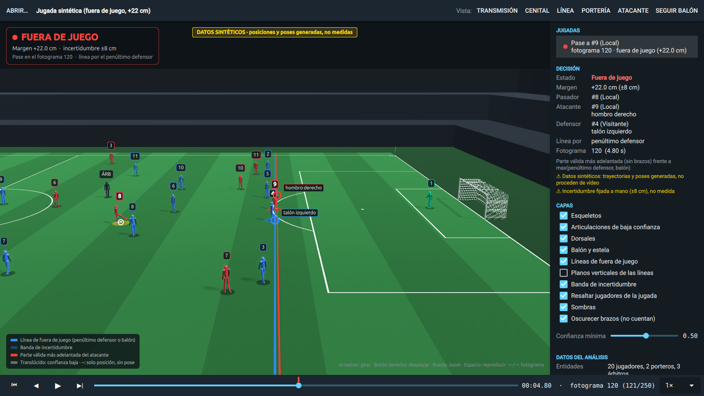
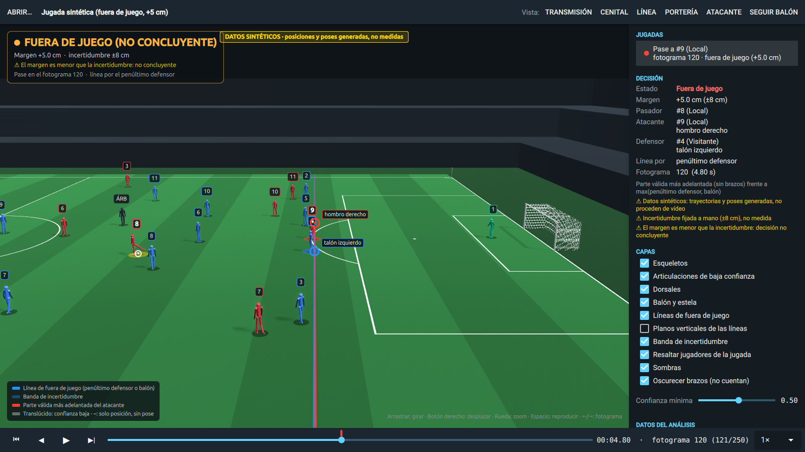

# Qt 3D viewer (`app/`)

C++17 / Qt Quick 3D application with two tabs. The user interface is in Spanish.

- **Análisis** (analysis): open a video, one or more images or a folder of frames and analyse one
  play with the Python backend.
- **Vista 3D** (3D view): shows a result in the [`offside-analysis` format](analysis_format.md):
  3D skeletons, ball, offside lines at the moment of the pass and the decision with its margin and
  uncertainty.

<p align="center">
  
  
</p>

## Analysis tab

1. **Pass frame:** find it with the slider or ←/→ (Shift: 10 frames) and press *Calibrar y
   detectar*. That frame is calibrated with the HRNet. If few pitch markings are visible, a nearby
   frame (within 2 s) with more markings is calibrated and the camera's pan and zoom are followed
   to the pass frame. The projected pitch lines are drawn on top, and a minimap shows the visible
   area.
2. **Attacked goal:** left or right, as shown in the minimap.
3. **Players:** click the attacker's box, then the second-last defender's. When the attacker is
   chosen a defender is proposed: the deepest visible one, or the next if the deepest looks like
   the goalkeeper.
4. **Apply Law 11:** 2D → 3D pose and comparison of the attacker's most advanced valid part (arms
   excluded) with the defender and the ball. The decision comes with margin, uncertainty and
   warnings; it can be opened in the 3D tab or as a VAR-style image with the lines.

The work is done by `scripts/inference/offside_backend.py`. The app starts it on first use and
keeps it open, so models load once; the HRNet runs in its Docker container. Results are written to
`<output_dir>/app/` (see `configs/paths.yaml`).

Environment variables:

| Variable | Default | Use |
|---|---|---|
| `OFFSIDE_PYTHON` | `python3` | Interpreter for the backend. Point it to the virtual environment where the package is installed. |
| `OFFSIDE_BACKEND` | path set at build time | Another backend script |

The same steps from the command line:

```bash
./build/offside_viewer --input clip.mp4 --frame 579 --goal right --attacker 15
```

`--input` (repeat it for several images), `--frame` (pass frame number), `--calibrate` (only
calibrate and detect), `--goal left|right`, `--attacker N` and `--defender N` (the proposed one if
omitted). With `--screenshot file.png` the capture waits until the analysis finishes.

## Requirements

Ubuntu 24.04 with Qt 6.4:

```bash
sudo apt install qt6-quick3d-dev qt6-shadertools-dev qml6-module-quick3d qml6-module-quick3d-helpers qml6-module-qtquick qml6-module-qtquick-controls qml6-module-qtquick-layouts qml6-module-qtquick-dialogs qml6-module-qtquick-window qml6-module-qtquick-templates qml6-module-qtqml qml6-module-qtqml-models qml6-module-qtqml-workerscript
```

`qt6-shadertools-dev` is required even though `qt6-quick3d-dev` does not pull it in. `ffmpeg` is
only needed to record demo videos (`--demo`).

## Build and run

```bash
cd app
cmake -S . -B build -DCMAKE_BUILD_TYPE=Release
cmake --build build -j
./build/offside_viewer sample_data/jugada_sintetica.json
```

Options: `--frame N` (start frame), `--camera transmision|cenital|linea|porteria|atacante`,
`--focus ID` (close-up of an entity), `--play` (start playing), `--size 1600x900`,
`--screenshot file.png` (saves the window after 3.5 s and exits) and `--demo out.mp4`
(`--demo-size WxH`) to record the scripted demo video.

## Controls

| Action | Control |
|---|---|
| Rotate / pan / zoom | drag with left / right button, wheel |
| Play or pause | space |
| Previous / next frame | ← / → (Shift: 10 frames) |
| Go to the selected pass | P |
| Views | 1 broadcast · 2 top-down · 3 line (aligned as in VAR) · 4 goal · 5 attacker |

Playback interpolates between frames, so slow motion (0.1×) is smooth.

## What is drawn

- **Skeletons:** spheres for joints and cylinders for bones in the team colour (goalkeepers and
  referees in their own). Arms are darker because they do not count for offside. Joints below the
  minimum confidence are translucent.
- **Players without a pose** (ground position only): a translucent cylinder and the number with
  `~`. No pose is made up.
- **Lines:** blue for the offside line (second-last defender or ball) with its uncertainty band;
  red for the attacker's most advanced valid part. Spheres mark the body points used and a bar on
  the grass the margin between them. If the margin is smaller than the uncertainty, the decision
  is shown in amber as not conclusive.
- A **synthetic data** banner when the file does not come from the real pipeline.

## Synthetic plays

`tools/generate_synthetic_play.py` generates test plays (a through ball with 22 players and
3 referees) and computes the decision from the poses with the offside rule:

```bash
python3 tools/generate_synthetic_play.py                          # offside, +22 cm
python3 tools/generate_synthetic_play.py --margin -0.15 -o sample_data/jugada_sintetica_legal.json
python3 tools/generate_synthetic_play.py --margin 0.05 -o sample_data/jugada_sintetica_ajustada.json
```

`tools/record_demo.sh` rebuilds the app and records the demo videos from the synthetic play.

## Source layout

| File | Role |
|---|---|
| `src/analysisdata.*` | Reading and validating the JSON |
| `src/scenecontroller.*` | Playback, interpolation between frames and data for QML |
| `src/skeletoninstancing.*` | Instance tables for joints, bones, heads and shadows |
| `src/pitchgeometry.*` | Mesh of the regulation pitch markings |
| `src/analysisbackend.*` | QProcess client of the Python backend |
| `src/framerecorder.*` | Frame-by-frame recording through ffmpeg |
| `qml/Main.qml` | Window, 3D scene, camera and shortcuts |
| `qml/AnalysisPage.qml`, `qml/PitchMinimap.qml` | Analysis tab |
| `qml/OffsideOverlay.qml` | Lines, uncertainty band and key points |
| `qml/SidePanel.qml`, `qml/TimelineBar.qml` | Play panel, layers and timeline |

Not done yet: playing the original video in sync (Qt Multimedia) and correcting players or the
pass instant by hand from the 3D view.
