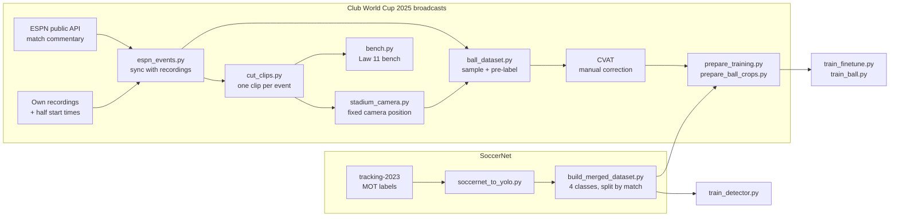

# How the data was built

None of the data, annotations or trained weights are published. SoccerNet data is distributed by
its authors under their own terms (an NDA is required for the videos), and the Club World Cup
broadcasts are copyrighted. This page describes how the data was obtained and processed so the
work can be reproduced with your own copies. The code for every step is in `scripts/`.

## 1. SoccerNet (base training set)

- **Source:** [SoccerNet](https://www.soccer-net.org/) tracking-2023 (broadcast clips with player,
  goalkeeper, referee and ball tracks) and the calibration-2023 set for the pitch keypoint HRNet.
  Both are downloaded with the official `SoccerNet` pip package after accepting its terms.
- **`scripts/data/soccernet_to_yolo.py`** converts the MOT annotations to YOLO boxes. SoccerNet
  writes the left goalkeeper as `goalkeepers team left` (with an *s*), so names are normalised
  first; otherwise that goalkeeper is silently dropped.
- **`scripts/data/build_merged_dataset.py`** merges the team-specific classes into four
  (`player`, `goalkeeper`, `referee`, `ball`). Teams are assigned later by shirt colour, because a
  detector does not generalise "left/right team" to unseen matches. Train and validation are split
  **by sequence**, never by frame, so near-identical consecutive frames cannot leak into validation.
- **`scripts/train/train_detector.py`** trains the 4-class YOLOv8s detector (at 640 and 1280 px).

## 2. Club World Cup 2025 broadcasts (domain data)

SoccerNet clips are older and lower quality than current broadcasts, and the detector had never
seen these kits or stadiums. Six matches of the 2025 FIFA Club World Cup, recorded privately, were
used to close that gap.

### Event timestamps from the ESPN API

`scripts/broadcast/espn_events.py` reads ESPN's public match summary endpoint
(`site.api.espn.com/.../fifa.cwc/summary?event=<id>`). Each commentary item has the game-clock
second, the real UTC time and often the pitch position. The script keeps offsides, goals,
penalties, corners, shots, fouls and kick-offs, and labels what each one is useful for
(Law 11 bench, detection, calibration or synchronisation).

Synchronising with a recording needs one number per half: the second of the recording where that
half kicks off (`inicio_s` in `partidos.json`, see `configs/partidos.example.json`). It was read
from the on-screen clock and checked at several points. The event's video second is that offset
plus the UTC time elapsed since kick-off, which handles stoppage time correctly (ESPN's game clock
stays at 45:00 / 90:00). ESPN does not record goal kicks, so they are inferred from a shot wide not
followed by a corner within 40 s. For offsides, ESPN names the passer; the player caught offside
is parsed from the text.

### Clips per event

`scripts/broadcast/cut_clips.py` cuts one clip per useful event, with a window that depends on the
event type (the pass comes a few seconds before the offside flag or the goal; a corner is taken
5-45 s after it is awarded). Clips are re-encoded so they start on an exact frame, and `clips.csv`
maps every clip frame back to the original recording.

### Fixed camera position per stadium

`scripts/broadcast/stadium_camera.py` calibrates frames from many clips of a match and takes the
median position of the main camera among those that agree. Since that camera only pans and zooms
during a match, later calibrations solve only for orientation and zoom, which is far more stable
when few markings are visible.

### Sampling and pre-labelling for CVAT

`scripts/broadcast/ball_dataset.py` samples frames around the moments where the detector fails
most (passes before offsides and goals, corners, free kicks, shots) plus random open play, from the
main camera only, split evenly across matches. Each frame is pre-labelled by the current detector
and corrected with the frame's calibration:

- people not standing on the pitch are removed (ball kids, bench, camera operators);
- the goalkeeper is the person near each goal line whose shirt colour matches neither team;
- detector "referees" are kept only if their colour matches neither team; assistants are found
  near the touchline;
- at most one ball, inside the pitch, never on a player's boots or on the penalty/centre spots
  (white boots and spots were the most common false balls).

Frames are sorted by review priority and exported as `imagenes.zip` + `anotaciones.zip` (YOLO 1.1)
to be imported into [CVAT](https://www.cvat.ai/), where every box was checked and corrected by
hand. `scripts/broadcast/relabel.py` redoes the pre-labels of an existing set with the ball-only
detector added.

### Training sets from the corrected exports

- **`prepare_training.py`** builds the fine-tuning set: corrected Club World Cup frames (repeated)
  plus a subsample of SoccerNet, so the model does not forget what it already knew. The split is by
  match.
- **`prepare_ball_crops.py`** builds 640×640 full-resolution crops for a ball-only detector, with
  hard negatives centred on players' feet. A fixed list of SoccerNet test sequences is never used
  for training so it can be measured on.
- **`train_finetune.py`** and **`train_ball.py`** train from the 4-class detector's weights.

## 3. Law 11 bench

`scripts/broadcast/bench.py` builds a regression bench from the clips: the offsides called by the
referee (from the ESPN commentary) as positives and goals that stood as negatives. A person marks
each play once in the app (pass frame, goal, attacker, defender); the bench then replays every play
with the current models and reports agreement with the official decision, calibration error and
2D/3D agreement. Attacker and defender are matched by box overlap, not by number, so the bench
keeps working when the detector changes.
